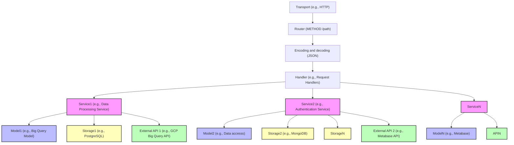

# Data management API for NAV

It serves a REST-API for managing data products, and provides functionality for self-service access to the data source.

## Getting started with local development

1. Install required dependencies

- https://clang.llvm.org
- https://docs.docker.com/engine/install/
- https://cloud.google.com/sdk/gcloud
- https://kubernetes.io/docs/tasks/tools/#kubectl

2. Configure `gcloud` so you can [access Nais clusters](https://doc.nais.io/operate/how-to/command-line-access/#google-cloud-platform-gcp)  
3. Login to GCP and configure docker
```bash
gcloud auth login --update-adc
gcloud auth configure-docker europe-north1-docker.pkg.dev 

# There also exists a make target for login to docker:
make docker-login
```
4. Login to nais and fetch local environment variables
```bash
nais auth login --nais
make env
```
5. (Optional) If you are on mac with arm (m1, m2, m3, etc.) install rosetta
```bash
softwareupdate --install-rosetta
```
6. Run with Azure auth locally
```bash
make run-online
```
5. Run som build commands

```bash
# Build all binaries
make build

# Run the tests
make test
```

## Run with fully local resources

*Note:* this does not currently work, and we might not try to revive it

With this configuration all dependencies run as containers, as can be seen in `docker-compose.yaml`:
- Google BigQuery using [bigquery-emulator](https://github.com/goccy/bigquery-emulator), with additional mocks for the 
  IAM Policy 
  endpoints
- Google Cloud Storage using [fake-gcs-server](https://github.com/fsouza/fake-gcs-server)
- [Metabase](https://github.com/metabase/metabase) with a [patch](resources/images/metabase/001-bigquery-cloud-sdk-no-auth.patch) for enabling use of bigquery-emulator
- Fake API servers for `teamkatalogen` and `naisconsole`

There are still a couple of services missing, though much functionality should work without this:
- Fetching of Google Groups
- Creating Google Cloud Service Accounts

1. Start the dependencies and API
```bash
# Starts the dependencies in the background, and runs the API in the foreground
$ make run
```
2. (Optional): Start the [nada-frontend](https://github.com/navikt/nada-frontend/?tab=readme-ov-file#development)

3. (Optional): Take a look at the [locally running Metabase](http://localhost:8083), the username is: `nada@nav.no`,
   and password is: `superdupersecret1`

## Making changes to the database or generated models and queries

1. [Migrations](pkg/database/migrations) allows you to modify the existing database, these are automatically applied during startup of the application
2. [Queries](pkg/database/queries) lets you generate new models and queries based on the existing structure

**NB:** If you make changes to the *Queries* remember to run the generate command so your changes are propagated:

```bash
$ make generate
```

## Making changes to api or Data Transfer Objects(DTOs)
1. We use tygo(https://github.com/gzuidhof/tygo) to generate Typescript types for DTOs.
2. When you change or add a DTO, they should be put in pkg/service folder.
3. run
```bash
$ make generate-ts
```
will generate the types by parsing .go files in pkg/service.

4. Changes to api url and request definition require manual coding for frontend api client, and the code is organized in frontend/lib/rest. 

**NB:** use inheriance in go types needs extra annotation for tygo: `tstype:",extends"`, look for examples if you are not familiar with it.

## Bumping the Metabase version
The file [.metabase_version](.metabase_version) controls the version of [Metabase](https://metabase.com) that is 
used in tests and for deployment to **dev** and **prod**. Check the Metabase [releases](https://github.com/metabase/metabase/releases) page 
for available versions; we follow the Metabase Enterprise track.

Minor upgrades (i.e. v1.x.x to v1.x.y) do not require downtime and can be applied directly by updating the `.metabase_version` file.

Pushing a version change to a branch runs the backend integration tests against the new Metabase version
and builds the deployment image. It does not automatically deploy to `dev`.
Merging to `main` deploys to `dev`, then to `prod` after the dev deployment succeeds.
The workflow waits for rollout in dev, but not in prod. A successful rollout does not replace functional checks.

### Major upgrades

Follow the [Metabase upgrade instructions](https://www.metabase.com/docs/latest/installation-and-operation/upgrading-metabase)
when upgrading across release lines that may migrate the application database, such as `v1.63.x` to `v1.64.x`.
Schedule a low-traffic maintenance window: the upgrade causes downtime.

1. **Scale down.** In a separate PR from `main`, set `spec.strategy.type: Recreate` and
   `spec.replicas.min/max: 1` in the [dev](.nais/dev/metabase/gcp.yaml) and
   [prod](.nais/prod/metabase/gcp.yaml) manifests. Keep `.metabase_version` unchanged.
   Merge and verify one Ready pod per environment, no remaining old pods, and the applied strategy
   and replica limits. `Recreate` prevents old and new versions from running together.
2. **Take backups.** Manually back up both Metabase application databases in Cloud SQL.
3. **Upgrade.** Update `.metabase_version`, confirm the PR tests pass, then merge to `main`.
   Keep the singleton configuration and follow migration logs in both environments.
   Do not restart, redeploy, or scale up while migrations are running.
4. **Verify.** Confirm completed migrations and Ready pods in both environments.
   Check login and a dashboard.
5. **Scale up.** Revert the preparation commit in a new PR, keeping the upgraded version.
   Remove `Recreate` and restore dev to `min: 1, max: 2` and prod to `min: 2, max: 4`.
   Merge only after verification, then check readiness and functionality again.

Dev waits for rollout with a 20-minute timeout; prod deploys automatically after dev succeeds
and does not wait for rollout. Check prod manually. A workflow timeout does not necessarily stop
the migration; inspect the pod before retrying.

If migration fails, stop further deployments and follow Metabase's recovery instructions.
Reverting only the image may be unsafe. If restoring a backup, stop all Metabase pods first
and restore the compatible old version as well. Changes since the backup will be lost.

## Bumping the Mocks version
In the [Makefile](Makefile) we set the target version for the mocks. If you change the mocks, you also need to bump 
the `MOCKS_VERSION`, so we get the latest changes.

## Update the images locally

We build and push images for the patched metabase and customized big-query emulator to speed up local development and integration tests. If you need to make changes to these: 

1. Make changes to the [base images](resources/images)

**Note:** building the big query emulator requires quite a bit of memory, so if you see something like `clang++:
signal: killed` you need to increase the amount of memory you allocate to your container run-time.

2. Build the new images locally
```bash
$ make build-all
```
3. (optional) Push the images to the container registry; requires that you have run `make docker-login`
```
$ make push-all
```

## Debugging a running process with IntelliJ
While this doc is written for IntelliJ, I believe it should work pretty much the same for VSCode or other editors.

1. Follow the setup guide: https://www.jetbrains.com/help/go/attach-to-running-go-processes-with-debugger.html#attach-to-a-process-on-a-local-machine
2. Step (2) in the guide linked above is covered by: `make run-online-dbg`

## Architecture


